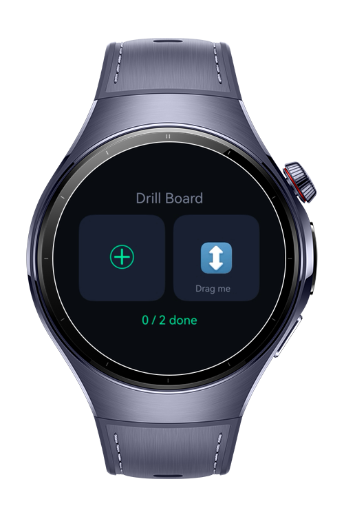
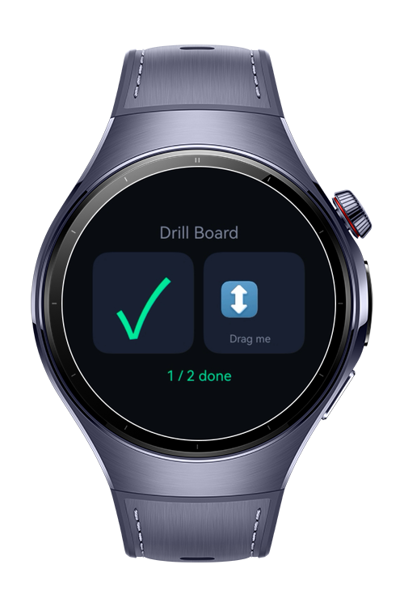
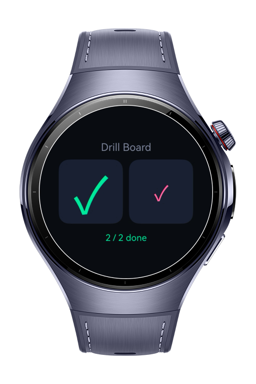

> **Note:** To access all shared projects, get information about environment setup, and view other guides, please visit [Explore-In-HMOS Index](https://github.com/Explore-In-HMOS/hmos-index).

# How to Build Gesture Drill Board

A glove-friendly gesture drill board for HarmonyOS Next smart wearables. The app presents a round watch-face layout with two interactive drill stations — **Pinch** and **Drag** — that exercise six ArkUI gesture and event APIs in a single, cohesive wearable task. Touch intent can change mid-task: the system reroutes gap-touches, filters gestures per station, moves icons inside tiles, and tunes frame rates on the fly.

# Preview

<div>
  
  
  
</div>

# Use Cases

- **Gesture Training**: Lets users practice pinch-to-zoom and drag interactions on a small wearable screen, especially useful for glove-friendly scenarios.
- **Touch Dispatch Demo**: Demonstrates how to forward touch events from dead zones (gaps between tiles) to the active drill station using custom event dispatch.
- **Frame Rate Optimization**: Shows how to dynamically boost frame rates during active gestures and throttle back at idle to conserve battery on wearable devices.

**Target APIs**

| Module | Method | Role |
|---|---|---|
| Custom Event Dispatch | `.onChildTouchTest` | Routes gap-touches to the active drill tile |
| BaseEvent | `.getModifierKeyState` | Detects hardware button combos for gloved users |
| Custom Gesture Judgment | `.onGestureJudgeBegin` | Accepts or rejects gestures per drill-station rules |
| DragController | `.createDragAction` | Launches programmatic drag for the drag-station tile |
| DynamicSyncScene | `.setFrameRateRange` | Boosts frame rate during gestures, lowers at idle |
| PinchGesture | `.onActionEnd` | Snaps scale value and marks pinch drill complete |

# Tech Stack

- **Languages**: ArkTS, ArkUI
- **Frameworks**: HarmonyOS SDK 6.0.0(20)
- **Tools**: DevEco Studio Version 6.0.0
- **Libraries & Kits**:
  - `@kit.ArkUI` — Custom Event Dispatch, Custom Gesture Judgment, DragController, DynamicSyncScene, PinchGesture
  - `@kit.ArkData` — UnifiedDataChannel (drag data payload)

# Directory Structure

```
entry/src/main/ets/
├── entryability/
│   └── EntryAbility.ets
│
├── pages/
│   └── DrillBoard.ets            // Main drill board page
│
├── components/
│   ├── PinchStation.ets          // Pinch-to-zoom drill tile
│   ├── DragStation.ets           // Drag-to-move drill tile
│   └── StatusRing.ets            // Circular progress ring
│
└── utils/
    └── FrameRateHelper.ets       // DynamicSyncScene wrapper
```

# Constraints and Restrictions

## Supported Device

- Huawei Watch 5

# License

How to Build Gesture Drill Board for Wearable is distributed under the terms of the [LICENSE](./LICENSE).
